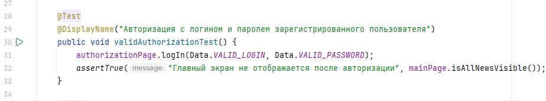

# Дипломный проект по профессии «Инженер по тестированию»

## Процедура запуска автотестов

### 1. Предварительные условия
- установить [**Java SE Development Kit  версии 11**](https://www.oracle.com/java/technologies/javase/jdk11-archive-downloads.html) на локальную машину;
- установить [**Android Studio**](https://developer.android.com/studio);
- настроить переменные среды: указать путь для ANDROID_HOME (например, C:\Users\space\AppData\Local\Android\Sdk) и JAVA_HOME (например, C:\Program Files\Microsoft\jdk-21.0.10.7-hotspot\);
- для формирования отчётов - установить [Allure Report](https://allurereport.org/docs/v2/install/).

### 2. Подготовка проекта к запуску автотестов
- склонировать репозиторий `https://github.com/cedric-ko/qamid-diploma` на локальную машину;
- открыть проект в Android Studio;
- дождаться завершения синхронизации Gradle.

### 3. Запуск автотестов в Android Studio
- перейти к Tool Windows (левая панель окна Android Studio либо выбрать меню View - Tool Windows) и выбрать тип отображения Project;
- в структуре проекта в Tool Windows перейти к `app/src/androidTest/java/ru.edu.qamid.ui/test`;
- для запуска всего набора тестов на папке `test` вызвать контекстное меню (клик правой кнопкой мыши), выбрать пункт меню 'Run 'Tests in 'ru.edu.qamid.ui'';
- для запуска отдельного тестового класса:
  * в папке `test` выбрать подпапку необходимого тестового класса (например, 'test/AuthorizationTest');
  * правым кликом мыши вызвать контекстное меню и выбрать пункт 'Run '<название теста>'' (например, 'Run 'AuthorizationTest'');
- для запуска отдельного теста:
  * в папке `test` выбрать файл необходимого тестового класса (например, 'test/AuthorizationTest');
  * двойным кликом открыть выбранный файл;
  * в открывшемся файле перейти к определённому тесту;
  * запустить тест кликом по кнопке 'Run Test' (зелёный треугольник) слева от теста, см. скриншот:
    

После выполнения указанных действий в окне Run Android Studio вы сможете наблюдать лог сборки проекта и выполнения тестов

**Примечание к запуску автотестов**
  1. В отдельных случаях анимация эмулятора может замедлять работу тестируемого приложения. Во избежание отставания потока приложения от автотеста рекомендуется перед запуском тестов отключить анимацию эмулятора, выполнив в терминале поочерёдно следующие три команды, каждую завершая нажатием Enter:
```
   adb shell settings put global window_animation_scale 0
   adb shell settings put global transition_animation_scale 0
   adb shell settings put global animator_duration_scale 0
```
  2. После полного прогона всего набора тестов в эмуляторе накапливается состояние (работа фоновых сервисов GMS, Play Store, auto-update и др., заполнение кэша и оперативной памяти). Для "чистого старта" при повторном прогоне полного набора тестов рекомендуется перезапустить эмулятор.

## Создание отчёта Allure Report
После завершения автотестов возможно формирование отчёта. Для этого необходимо:
- в Android Studio выбрать меню View - Tool Windows - Device Explorer;
- в открывшемся окне отображения структуры эмулятора перейти к `/data/data/ru.edu.qamid/files/allure-results`;
- правым кликом на папке `allure-results` вызвать контекстное меню и выбрать пункт `Save As...`;
- создать в корне проекта папку `allure-results` и выбрать её для сохранения файлов отчёта из эмулятора;
- сформировать отчёт соответствующей командой в терминале:
  * `allure serve` для старта временного сервера и открытия отчёта в браузере
  * `allure generate allure-results -o allure-report` для формирования отчёта в html-файле
  * `allure open allure-report` для открытия в браузере сформированного html-отчёта

## Тестовая документация
- [план тестирования](Plan.md);
- [чек-лист](Check.xlsx);
- [тест-кейсы](Cases.xlsx);
- [баг-репорты](https://github.com/cedric-ko/qamid-diploma/issues);
- [отчёт Allure Report](allure-results.zip) в zip-архиве; 
- [отчет о тестировании](Result.md).
